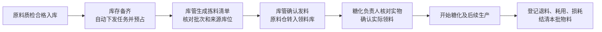

# 生产领料流程

## 正常流转

自动下发只创建任务和预占库存，不替代库管发料，也不代表生产已经开工。收货、质检入库和领料分别记录不同的实际动作。

| 步骤 | 负责人 / 入口 | 库存影响 | 页面状态 |
| --- | --- | --- | --- |
| 备货齐套 | 系统，生产计划 | 预占本批所需合格原料，不移动库存 | 已下发，待备料 |
| 核对拣料 | 库管，库存采购 → 生产领料 | 按本厂区可用库存推荐批次并预占；同原料不同工序合并，优先较早到期批次 | 待发到领料库 |
| 确认发料 | 库管，领料明细 | 按原批次从来源库位转到指定领料库；公司总库存不变，领料库不参与其他批次可用库存核算 | 待确认实领 |
| 确认实领 | 本批糖化负责人，我的生产任务 → 糖化执行清单 | 核对交接，不重复扣减库存 | 已确认实领 |
| 开始生产 | 对应生产负责人 | 正式更新生产批次状态；自定义糖化流程也必须通过实领校验 | 执行中 |
| 登记去向 | 本批负责人、生产总监或管理员，生产计划领料明细 | 余料原批次退回原库位，耗用转生产，损耗单独记账 | 已结清 |

## 页面安排

- **生产领料**：独立 Tab，默认待处理，支持搜索与进度筛选、底部分页；没有领料单的待备料任务同样展示。
- **库管领料明细**：选择本厂领料库位 → 生成拣料清单 → 按清单核对批次、来源库位、数量 → 确认发料。推荐后没有发生实物移动，可重新推荐批次。
- **糖化执行清单**：工序前显示领料单、领料库、原料批次和发料数量；负责人确认实领后才开放生产操作。
- **生产计划**：展示核对拣料、发到领料库、确认实领、登记物料去向四步进度，以及发料、实领、结清时间。

## 差异和关闭规则

1. 发料前库存、效期、冻结或质检状态发生变化，系统拦截发料，库管重新推荐并核对批次。
2. 未确认实领发现发错：库管实际收回本单全部原料，点击“发料有误，收回重发”；系统原批次退回原库位、恢复备料任务并重新生成推荐清单。生产方不能直接改小实领数字掩盖差异。
3. 实领确认后不能撤回发料。余料按退料登记，损耗和实际耗用分别记录。每个批次必须满足：**实领 = 累计退料 + 实际耗用 + 损耗**。
4. 取消或终止计划前，已发出的原料必须先收回或结清。尚未发料的推荐单可以随计划关闭，库存预占同时释放。
5. 同一计划不能重复创建普通领料单；已完成的发料不能再次发出。动作使用版本校验和数据库锁，并沿用接口幂等校验。
6. 当前界面按计划整批领料，不提供随意超领或替代原料；超领沿用已有审批规则。后续若需要分次领料，应增加明确的补领单，而非再次执行已完成的发料。

## 本地配置（2026-10-29）

试运行厂区、铜陵厂均已配置独立领料库和“领料暂存区”，没有迁移现有原料库存。新建领料库会自动创建默认暂存库位。

新增采购 cg、财务 cw、总部生产计划 scjh 三个岗位账号，仅授予对应岗位权限；初始密码单独交付，不存入代码仓库。

## 参考

- ERPNext Work Order：需求、已转移、已消耗数量及余料退回：https://docs.frappe.io/erpnext/work-order
- ERPNext 库存预占：原料仓转入 WIP 后按工单占用：https://docs.frappe.io/erpnext/stock-reservation-for-work-order
- Odoo 三步制造：拣料转移、生产、成品存放分别记录：https://www.odoo.com/documentation/saas-18.3/applications/inventory_and_mrp/manufacturing/basic_setup/three_step_manufacturing.html
